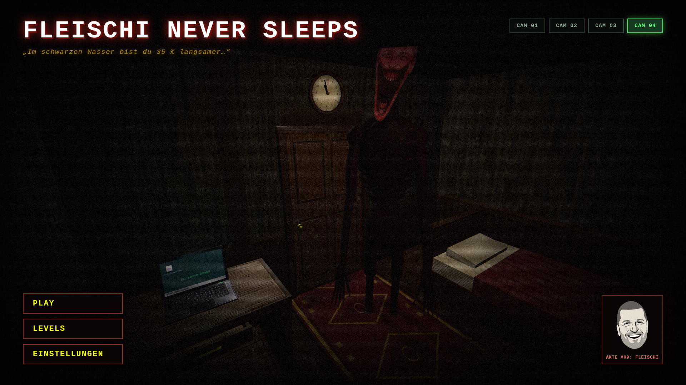
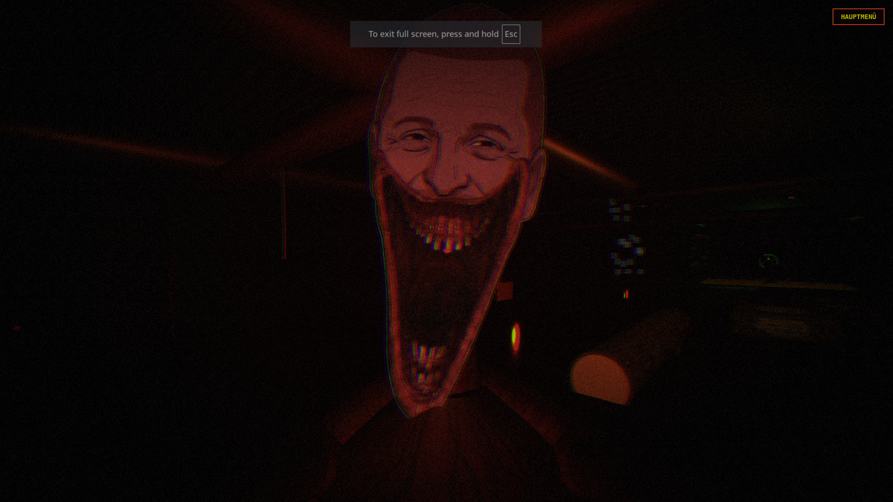
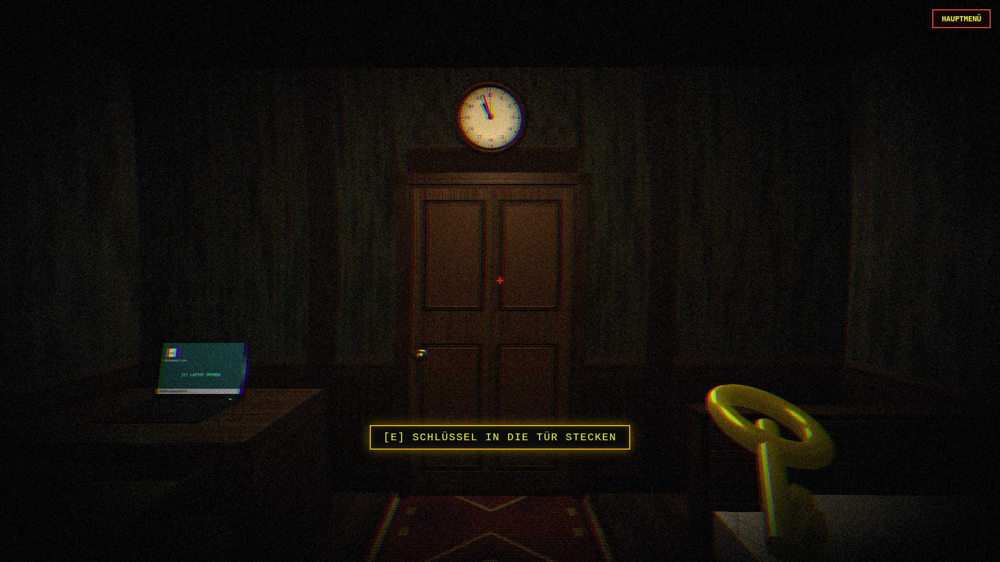
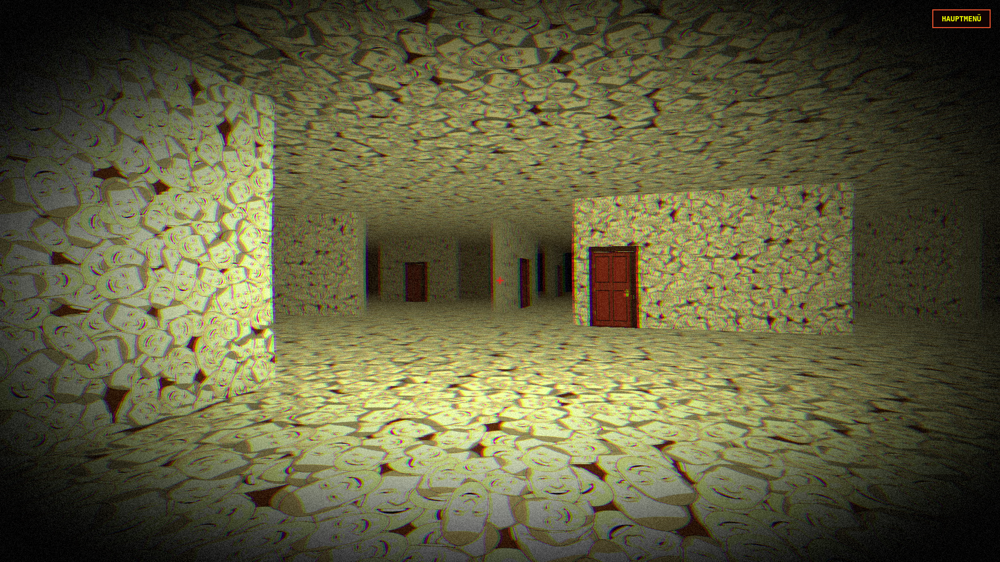
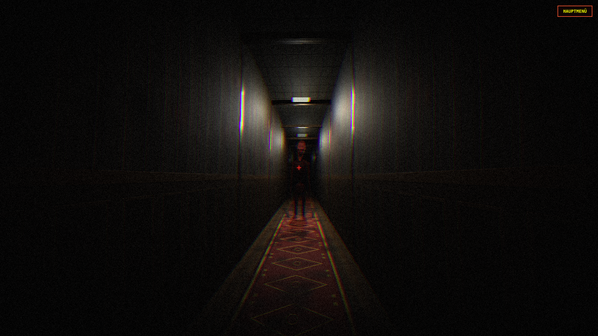
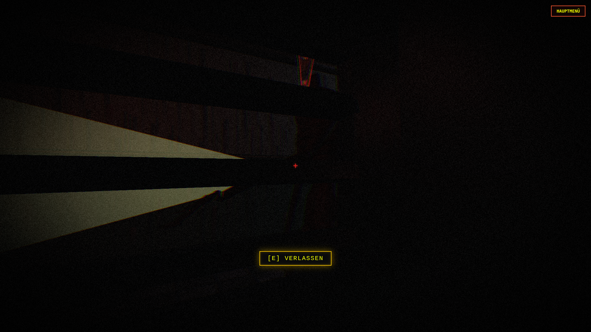
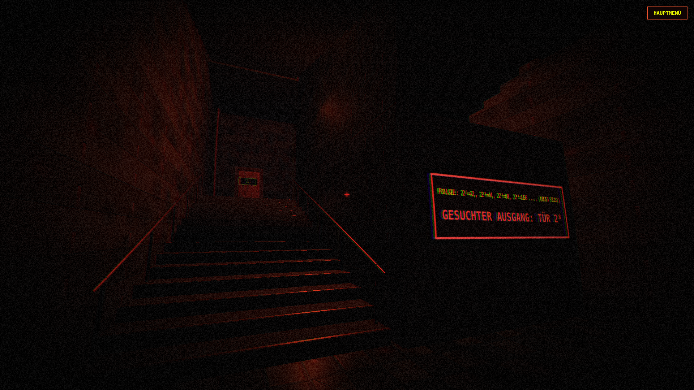
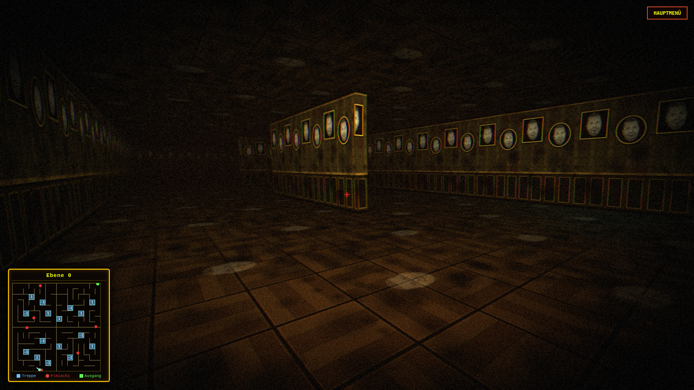
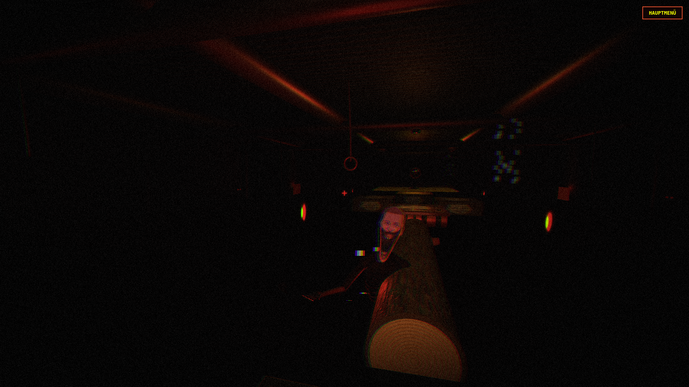
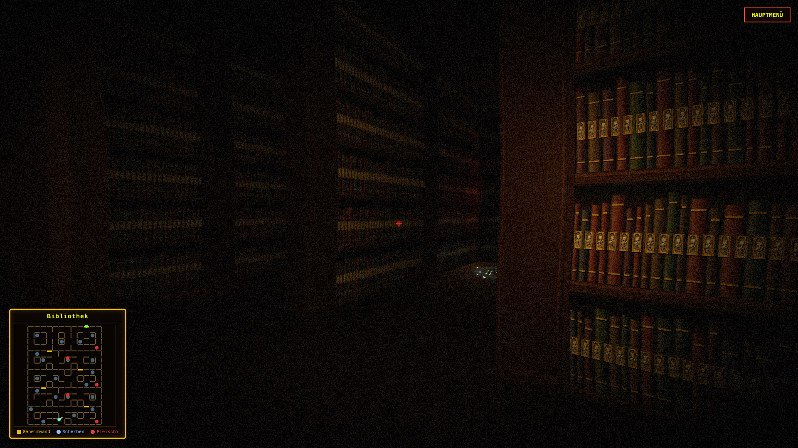

# Fleischi Never Sleeps

Ein webbasiertes 3D-First-Person-Horrorspiel auf Basis von Three.js und WebGL 2.0. Das Spiel kombiniert Flucht- und Stealth-Mechaniken, mathematische Rätsel, Parkour-Passagen und Labyrinth-Erkundung in einer zusammenhängenden Kampagne bei einer Gesamtgröße von unter 5 MB.

---

## Inhaltsverzeichnis

1. [Übersicht](#übersicht)
2. [Hauptmerkmale](#hauptmerkmale)
3. [Level-Übersicht](#level-übersicht)
4. [Steuerung](#steuerung)
5. [Installation und Lokaler Start](#installation-und-lokaler-start)
6. [Systemanforderungen](#systemanforderungen)
7. [Projektstruktur](#projektstruktur)
8. [Technische Architektur](#technische-architektur)
9. [Vorschau / Screenshots](#vorschau--screenshots)

---

## Übersicht

In "Fleischi Never Sleeps" erwachst du um Mitternacht in einem verlassenen Schul- und Wohnkomplex. Das feindliche Wesen Fleischi lauert in den Schatten und reagiert auf Schrittgeräusche, Erschütterungen und Fehler bei elektronischen Schließmechanismen. Ziel des Spiels ist es, alle sechs Abschnitte zu überleben, Rätsel zu lösen und den finalen Ausgang zu erreichen.

---

## Hauptmerkmale

- **Minimaler Speicherbedarf:** Vollständiges Spiel inklusive Assets, Geometrien und Audio-Synthesizer unter 5 MB.
- **Prozedurale Textur-Generierung:** Alle Texturen (Damast-Tapeten, Parkettböden, Kassetten-Türen, Fliesen, Sichtbeton, Baumrinde und Buchrücken) werden zur Laufzeit dynamisch über HTML5 Canvas-Generatoren erzeugt.
- **Retro-Horror-Shader:** CRT-Scanlines, chromatische Aberration, Vignettierung und volumetrischer Distanznebel über Custom-Post-Processing.
- **Integrierte 3D-Bedienelemente:** Nahtlos in die Spielwelt eingepasste Schließsysteme (z. B. ins Türholz eingelassene Tastaturfelder, Aufzug-Terminals).
- **Stealth- und Akustik-System:** Versteckmechanik in Spinden, kreisförmige Glasscherben-Schallfallen und Sichtlinienprüfung für patrouillierende Gegner.
- **Spielmodi:**
  - *Kampagne (Play):* Zusammenhängender Durchlauf durch alle Level mit Freischaltlogik.
  - *Level-Auswahl (Levels):* Direkte Anwahl bereits absolvierter Abschnitte mit automatischer Rückkehr ins Menü.
- **CCTV-Hauptmenü:** Live-Überwachungskamera-Ansichten (CAM 01 bis CAM 04) mit Kameraschwenks und dynamischen Statusmeldungen.

---

## Level-Übersicht

### 1. Nachsitzen um Mitternacht (Schlafzimmer & Aufzug)
Erkunden des Startzimmers, Auffinden des Schlüssels über den Laptop, Aktivieren der analogen Wanduhr und Gravieren der Mitternachtsformel in das Terminal der Zimmertür. Anschließende Flucht durch den Korridor in den Fahrstuhl, Lösen des Absolutglied-Codes und Absturz der Kabine.

### 2. Die Fleischrooms
Endlose, labyrinthische Gänge mit Gesichter-Mustern. Der Spieler muss zehn markierte Türen öffnen, während unvorhersehbare Countdowns Fleischis Verfolgung auslösen.

### 3. Schulflur & 2er-Potenzen
Schleichpassage durch dunkle Schulflure. Patrouillierende Taschenlampen-Wachen müssen durch Verstecken in Spinden umgangen werden. Im anschließenden Bunker-Treppenhaus muss die Tür mit dem Wert 2⁸ (Tür 256) identifiziert werden.

### 4. Mega Labyrinth
Ein vertikales Labyrinth über drei Stockwerke (Ebene -1, 0 und 1) mit Rampensystemen, Orientierungs-Minimap und barocken Gemälderahmen. Das Ziel ist das geöffnete Doppelportal im Nordosten.

### 5. Gefluteter Heizungskeller
Ein industrieller Abwasserkanal mit 35 % Geschwindigkeitsreduktion im Wasser. Der Parkour erfordert präzise Sprünge über Kisten, driftende Fässer-Flöße und schwimmende Holzstämme, um drei Druckventile zu aktivieren und den Ausgang freizuschalten.

### 6. Schul-Bibliothek (Flüster-Labyrinth)
Ein 40.8 x 54.4 Meter großes Areal mit hohen Bücherregal-Schluchten. Fünf Decken-Kronleuchter markieren geheime Bücherwände, die über Wandleuchter-Hebel geöffnet werden müssen. Kreisrunde Flaschenscherben-Felder erfordern Schleichen oder Überspringen, um keine akustischen Alarme auszulösen.

---

## Steuerung

Die Tastenbelegung kann im Hauptmenü unter "Einstellungen" konfiguriert werden.

| Funktion | Standardtaste |
|---|---|
| Vorwärts | `W` |
| Rückwärts | `S` |
| Links | `A` |
| Rechts | `D` |
| Sprinten | `Shift Links` |
| Schleichen / Ducken | `Strg Links` |
| Springen | `Leertaste` |
| Interagieren | `E` / `Linksklick` |
| Kamerasicht | `Maus` |
| Menü / Abbrechen | `Escape` |

---

## Installation und Lokaler Start

Aufgrund von Browser-Sicherheitsrichtlinien für ES-Module (CORS) muss das Projekt über einen lokalen HTTP-Server ausgeführt werden.

### Option 1: Python
```bash
python3 -m http.server 8000
```
Anschließend im Browser aufrufen: `http://localhost:8000/public/`

### Option 2: Node.js
```bash
npx serve public
```

### Option 3: VS Code Live Server
Rechtsklick auf `public/index.html` und "Open with Live Server" auswählen.

---

## Systemanforderungen

### Mindestanforderungen (720p bis 1080p bei ca. 30 FPS)
- **Betriebssystem:** Windows 10 (64-Bit), Ubuntu Linux 20.04+ (64-Bit) oder macOS 11+
- **Prozessor:** Dual-Core 2.0 GHz (Intel Core i3 ab 4. Gen / AMD Athlon 3000G / Ryzen 3)
- **Arbeitsspeicher:** 4 GB RAM (mindestens 1.5 GB freier RAM für den Browser-Tab)
- **Grafikkarte:** Integrierte GPU mit WebGL 2.0 Support (Intel HD Graphics 520/620 oder AMD Radeon Vega 3)
- **Festplattenspeicher:** ca. 50 MB freier Speicherplatz
- **Browser:** Google Chrome, Mozilla Firefox, Microsoft Edge oder Brave mit aktivierter Hardwarebeschleunigung

### Empfohlen (1080p bis 1440p bei 60+ FPS)
- **Betriebssystem:** Windows 10/11 (64-Bit) oder Linux Ubuntu 22.04+
- **Prozessor:** Quad-Core 3.0 GHz+ (Intel Core i5 ab 8. Gen / AMD Ryzen 5 ab 2000er Serie)
- **Arbeitsspeicher:** 8 GB RAM oder mehr
- **Grafikkarte:** Dedizierte GPU (NVIDIA GeForce GTX 1050 / GTX 1650 oder AMD Radeon RX 560 / RX 5500)
- **Grafikspeicher:** 2 GB VRAM
- **Audio:** Stereo-Headset für räumliche Schallortung

---

## Projektstruktur

```text
FleischiNeverSleeps/
├── Hardware.txt
├── README.md
├── preview/
│   ├── 2erPotenzZahlen.png
│   ├── Bibiothek.png
│   ├── FleischiFasst.png
│   ├── Fleischrooms.png
│   ├── flur.png
│   ├── Heitzungskeller.png
│   ├── Labyrinth.png
│   ├── menu.png
│   ├── School.png
│   └── zimmer.png
└── public/
    ├── index.html
    ├── assets/
    │   ├── soundeffect/
    │   └── textures/
    │       ├── fleischi_face.png
    │       └── fleischi_face_monster.png
    └── src/
        ├── main.js
        ├── PlayerController.js
        ├── PhysicsEngine.js
        ├── AudioSynthesizer.js
        ├── PostProcessing.js
        ├── ProceduralTextures.js
        ├── FleischiMonster.js
        ├── MitternachtTerminal.js
        ├── BackroomsLogic.js
        ├── Level01Room.js
        ├── HallwayManager.js
        ├── FleischroomsManager.js
        ├── SchoolLevelManager.js
        ├── MultiFloorLabyrinthManager.js
        ├── FloodedBoilerManager.js
        └── WhisperLibraryManager.js
```

---

## Technische Architektur

- **Rendering:** Three.js `WebGLRenderer` mit `PCFSoftShadowMap`, Frustum Culling und dynamischem Nebel.
- **Kollision & Physik:** Eigene AABB-Kollisionserkennung mit kontinuierlicher Bewegungsauflösung, Rampen-Interpolation und Schwerkraftberechnung in `PhysicsEngine.js`.
- **Audio-Engine:** Hybrides System in `AudioSynthesizer.js`, das reale MP3-Samples asynchron puffert und mit parametrischen Web-Audio-Oszillatoren (Sawtooth, Triangle, Square, Bandpass-Filter) kombiniert.
- **Zustandsspeicherung:** Persistente Speicherung freigeschalteter Level und individueller Tastaturbelegungen über das `localStorage`-Interface.

---

## Vorschau / Screenshots

### Interface & Antagonist

| Hauptmenü | Fleischi Monster |
| :---: | :---: |
|  |  |

### Level-Impressionen

| Level 1: Schlafzimmer | Level 2: Die Fleischrooms |
| :---: | :---: |
|  |  |

| Level 3: Schulflur (Ansicht 1) | Level 3: Schulflur (Ansicht 2) | Level 3: 2er-Potenzen |
| :---: | :---: | :---: |
|  |  |  |

| Level 4: Mega Labyrinth | Level 5: Heizungskeller | Level 6: Schul-Bibliothek |
| :---: | :---: | :---: |
|  |  |  |

